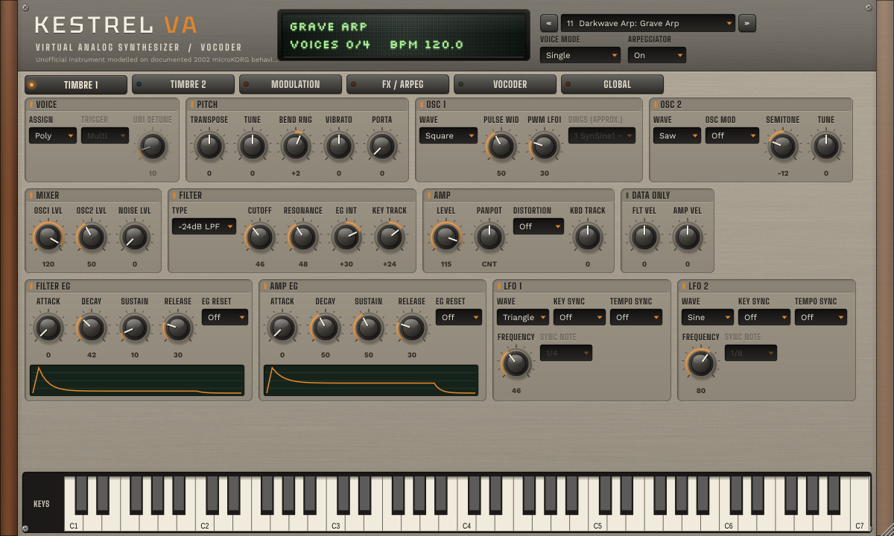

# Kestrel VA

**Kestrel VA** is an original virtual-analog synthesizer and vocoder (VST3 instrument,
Standalone app and VST3 effect variant). Its sound engine behaviourally models the documented
architecture of the original **2002 KORG microKORG**: two timbres, the eight OSC1 waveforms,
OSC2 ring and sync, a multimode filter, two EGs, two LFOs, four virtual patches,
Mono/Poly/Unison with the 4-voice allocation rules, the step arpeggiator, MOD FX, delay, EQ and
the 8-channel vocoder.

> Kestrel VA is an independent project. It is not made, endorsed or supported by KORG, and it
> contains no KORG code, data, logos or graphics. "microKORG" is used only to name the
> reference instrument whose *documented* behaviour is modelled. Without hardware measurements
> it is an approximation; see `docs/STATUS.md`.



## Quick start

- **Windows:** download the **KestrelVA-windows-x64** artifact from the latest *Kestrel VA
  build* run in GitHub Actions, then copy `Kestrel VA.vst3` (and optionally `Kestrel VA
  FX.vst3`) to `C:\Program Files\Common Files\VST3\`. Alternatively, build it yourself
  ([docs/BUILD.md](docs/BUILD.md)).
- **FL Studio:** see [docs/FL_STUDIO.md](docs/FL_STUDIO.md), especially for the vocoder (use
  *Kestrel VA FX* on a mixer insert with a MIDI Out channel).
- **Build from source:**

```bash
cmake -S kestrel -B build -G "Visual Studio 17 2022" -A x64 && cmake --build build --config Release
```

## Documentation

| Document | Contents |
|---|---|
| [docs/ARCHITECTURE.md](docs/ARCHITECTURE.md) | signal flow, parameter reference, modulation routing, voice allocation, evidence levels ([DOC]/[FIG]/[ENG]/[EXT]), sources, unknowns register |
| [docs/STATUS.md](docs/STATUS.md) | implemented features, verified behaviour with measurements, limitations |
| [docs/PRESETS.md](docs/PRESETS.md) | the 268 factory programs by section, with descriptions |
| [docs/BUILD.md](docs/BUILD.md) | build instructions, options, CI binaries, plug-in check |
| [docs/FL_STUDIO.md](docs/FL_STUDIO.md) | FL Studio setup and audio-input routing |
| [docs/REFERENCE_CAPTURE.md](docs/REFERENCE_CAPTURE.md) | how to record an original unit and compare it with Kestrel |

## Repository layout

```
kestrel/
  engine/      pure C++20 sound engine (no JUCE): params, osc, filter, env, lfo, voice,
               timbre, fx, vocoder, arp, io
  plugin/      JUCE processor, editor/UI, factory bank, fonts, host-check and snapshot tools
  tools/       kestrel_render, kestrel_capture, kestrel_compare
  tests/       engine test suite (ctest)
  presets/     factory programs (.kvp text files) + bank order
  docs/        documentation and screenshots
```

## Offline tools

```bash
build/tools/kestrel_render -p presets/23-grave-arp.kvp -n 57,100,0,2 -n 60,100,0,2 -n 64,100,0,2 -t 4 -o grave.wav
```

```bash
build/tools/kestrel_capture capture --render
```

```bash
build/tools/kestrel_compare capture/12_x.hw.wav capture/12_x.kestrel.wav --report report.md
```

## Licences

Kestrel's own code is original. JUCE 8 is dual-licensed (AGPLv3 / commercial). The UI fonts
(Big Shoulders, Work Sans, Tektur, Silkscreen) are under the SIL Open Font License 1.1, with
their licence texts in `plugin/resources/fonts/`.
